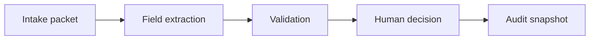

# Aegis

Follow a fictional onboarding case from document intake through validation to a reasoned human decision.


## Install and verify

Use Python 3.13 from the project directory.

```sh
python3 -m venv .venv
source .venv/bin/activate
python -m pip install -r requirements.txt
python -m pytest -q
streamlit run app.py
```

The first launch creates 40 cases. To generate a sample JSON packet, use the download in Intake simulator.

Open case 40, inspect its expired identity and mismatched address, then use the intake simulator to submit a clean business case. Record a reasoned decision and inspect its audit snapshot.

## Architecture



## Engineering decisions

**Use structured packets** JSON allows field-by-field extraction with known expected values and a 64 KiB limit. OCR would require an additional recognition benchmark. Tests reject unsupported types and oversized packets.

**Separate completeness from inconsistency** An absent address triggers a request for evidence. A conflicting address identifies two values to reconcile. The completeness test removes every document and verifies the manual-review category.

**Commit decisions with their evidence** SQLite writes the case revision and audit snapshot in one transaction. A stale revision is rejected. The workflow test corrects an address, approves the case and verifies that the original mismatch survives.

## Evidence

**40 reproducible starting cases** Generated individual and business records exercise missing documents, expiry and mismatched addresses. Seeded handling times are simulated.

**Correction and stale-write checks** The automated workflow covers correction, approval, rejection of an invalid transition, stale edits and reopening. Browser verification also submitted a fresh synthetic case.

## Next iteration

**Strengthen access control** Authenticate reviewers and enforce permissions at each transition.

**Measure review effort** Track real handling intervals separately from time spent waiting for applicant information.

## Deployment and limits

Use a Python host with a writable directory and app.py as the Streamlit entrypoint. The SQLite file is created beside the app. Export findings before resetting an ephemeral host. Selectable demo reviewers provide attribution inside the simulation. Production deployment would require authenticated actors, enforced roles, retention rules and independently protected logs.

AI coding tools assisted implementation and testing. The examples are synthetic.

## Licensing

Original source is provided for portfolio review. No open-source redistribution license has been selected. Dependencies retain their upstream licenses.
