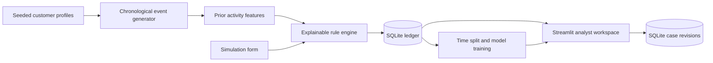

# Sentinel AI

A financial fraud and risk intelligence workspace for investigating synthetic transactions. Follow a flagged transfer from a portfolio-level alert to its customer history, inspect the evidence behind each score, and record an investigation decision in SQLite.


## Run locally

Use Python 3.13. From the repository root:

```sh
python3 -m venv .venv
source .venv/bin/activate
python -m pip install -r requirements-dev.txt
streamlit run app.py
```

Streamlit prints the local URL. The first visit generates 100,000 transactions and builds two models. Subsequent visits reuse the database and running process cache. No API keys or customer data are required.

## Try an investigation

1. Open **Overview** and select a row in the priority queue. Inspect the triggered rules, anomaly percentile, supervised score and earlier customer activity.
2. Change the case to **Investigating**, enter a synthetic note and save. Download the case CSV. Reopen that transaction to retrieve the latest saved revision.
3. In **Transaction explorer**, filter by date, amount, type, risk, country, merchant, customer or label. Search IDs, sort across matching records, page through results and export the filtered ledger.
4. In **Customer profiles**, inspect the timeline, historical device and country fields, typical spend and recent transaction counts.
5. In **Risk simulator**, compare an everyday purchase with a rapid transfer. Adjust the inputs and submit again. In **Model performance**, move the cutoffs and inspect false positives on the holdout.


## Architecture



Python, Pandas and NumPy generate and summarize the event stream. SQLAlchemy manages SQLite transactions. Scikit-learn fits Isolation Forest and logistic regression. Streamlit and Plotly render the workspace. The simulator calls the shared rule and model code in memory. Only case edits persist from the UI.

The fixed seed is 42. Positive labels come from seeded scenarios. Benign clusters and low-signal positives make detection imperfect. The historical spending mean uses only earlier events and a customer-specific starting prior. See the [methodology](docs/methodology.md) for rule definitions and labeling details and [engineering decisions](docs/engineering-decisions.md) for the implementation tradeoffs.

## Verification

All nine tests passed on Python 3.13. Run `python -m pytest -q`. The suite covers reproducibility, prior-only history, missing and invalid fields, duplicate IDs, rule contributions and cutoff boundaries, model inputs, unseen countries, empty filter results, database initialization, saved case revisions and stale writes. A Streamlit workflow test exercises all seven pages, case-note persistence and simulator submission.

The default ledger contains 2,162 synthetic positive labels. The last 20,000 transactions contain 414 positives. Measured on this chronological holdout with default settings:

| Method and cutoff | Precision | Recall | F1 | False-positive rate | False positives |
|---|---:|---:|---:|---:|---:|
| Rules ≥ 25 | 36.2% | 86.0% | 51.0% | 3.20% | 627 |
| Isolation Forest ≥ 98th training percentile | 68.9% | 62.6% | 65.6% | 0.60% | 117 |
| Logistic regression ≥ 0.50 | 68.8% | 52.2% | 59.3% | 0.50% | 98 |
| Amount ≥ training 99th percentile | 48.3% | 24.6% | 32.6% | 0.56% | 109 |

At these cutoffs the rules found 356 positives. Isolation Forest found 259 and sent 510 fewer label-0 transactions to review. These results describe this generator and seed. Real financial data, fraud prevalence, calibration and analyst workload can differ substantially.

## Free deployment

Push the source to a GitHub repository. In Streamlit Community Cloud, create an app, select that repository, the `main` branch and `app.py`, and choose Python 3.13. Deploy, wait for startup, open the assigned URL and verify the overview and simulator. [Streamlit deployment guide](https://docs.streamlit.io/deploy/streamlit-community-cloud/deploy-your-app/deploy)

The default SQLite file is `data/sentinel.sqlite`. On a constrained host, set `SENTINEL_ROWS=20000` and `SENTINEL_DB=data/demo-20k.sqlite` before first launch. Existing databases retain their original rows. A different row count changes the synthetic population and metrics. For a fresh reproducible dataset choose a new database filename. Export any case findings before a host reset.

## Scope and next steps

This portfolio project uses AI-assisted coding, synthetic financial behavior and illustrative review policies. Anomaly percentiles rank unusual observations. Logistic outputs estimate the synthetic target and have no real-world calibration study. The project demonstrates software and analytical workflows without a claim of deployment in banking or measured business savings.

Future improvements include evaluation across multiple seeds and drift regimes, account-level holdouts, authenticated work queues and durable audit history.
