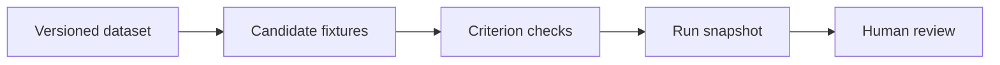

# Veritas

Compare two candidate responses against the same evidence, then trace a failed score back to the exact criterion.


## Install and verify

Use Python 3.13 from the project directory.

```sh
python3 -m venv .venv
source .venv/bin/activate
python -m pip install -r requirements.txt
python -m pytest -q
streamlit run app.py
```

Run `python lab.py > cases.json` to export the synthetic benchmark. Use Datasets to import edited fixtures.

Open Experiment register and record both fixture sets at 100. Expect 200 and 258 passing responses. Inspect a failed field and append a reviewer score.

## Architecture



## Engineering decisions

**Grade known claims** Exact and numeric checks make failures reproducible. A semantic judge could accept paraphrases but would need its own validation. Tests include a valid object with the wrong field type.

**Freeze the evidence** A content hash identifies each dataset. SQLite stores the response, criterion results, grader version and threshold at run time. Snapshots use more space but preserve old results when a dataset changes.

**Keep human judgments alongside scores** Reviewers can assign a different score, explain it and mark ambiguity. Appending reviews preserves disagreement. A test checks that two reviews leave the automated snapshot intact.

## Evidence

**Five task families** Each family contains 60 generated examples. The benchmark contains factual lookup, invoice extraction, formatting, numerical analysis and uncertainty.

**200 versus 258 strict passes** With a 100-point cutoff, 200 of 300 direct-answer fixtures and 258 of 300 evidence-first fixtures passed. Incorrect answers were injected by construction. This exercises the grader and makes no claim about model quality.

## Next iteration

**Validate the rubric** Collect independently scored responses from two reviewers, measure agreement and inspect ambiguous cases.

**Test live candidates** Record actual model outputs with prompt, model version and decoding parameters before comparing them.

## Deployment and limits

Use a Python host with a writable directory and app.py as the Streamlit entrypoint. The SQLite file is created beside the app. Export findings before resetting an ephemeral host. Known reference facts support narrow claims. Paraphrases, open-ended reasoning and subjective usefulness require human review. Candidate responses are authored fixtures.

AI coding tools assisted implementation and testing. The examples are synthetic.

## Licensing

Original source is provided for portfolio review. No open-source redistribution license has been selected. Dependencies retain their upstream licenses.
